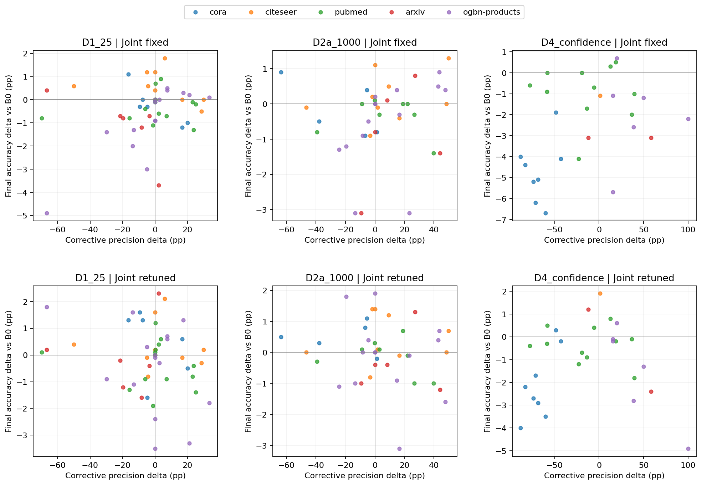
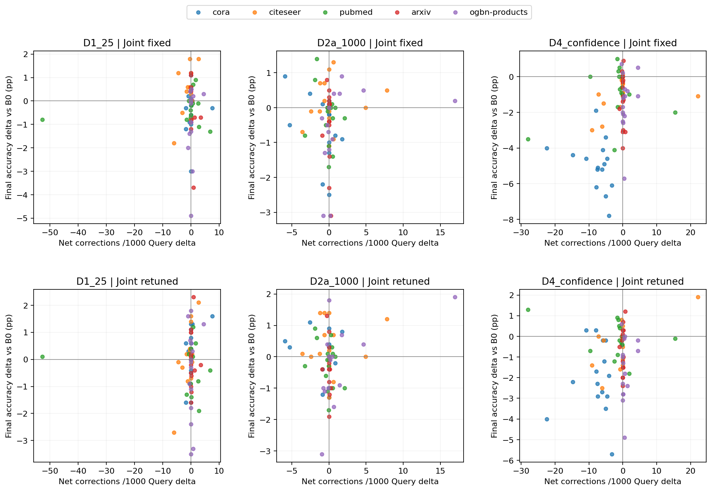

# 纠正性指标与最终准确率：配对相关及不确定性

全部使用相对B0的配对差值，D2匹配剔除新增训练节点后的Query。同一比较两种相关系数使用相同完整样本。按dataset×seed簇重采样4000次，保持同seed三种shot相依；数据集内只有5个seed簇，区间须谨慎解释。
不显著不能证明不相关；相关更强也不等于机制已被因果识别。Joint重调同时改变多项数值参数。

| Dataset | Treatment | Joint | Predictor | Method | n | r | Overall-precision r | Difference | Difference 95% CI |
|---|---|---|---|---|---:|---:|---:|---:|---|
| ALL | D1_25 | fixed | corrective_precision_delta_pp | Pearson | 51 | +0.252 | -0.037 | +0.289 | [-0.273, +0.655] |
| ALL | D1_25 | fixed | corrective_precision_delta_pp | Spearman | 51 | +0.210 | +0.040 | +0.170 | [-0.172, +0.499] |
| ALL | D1_25 | fixed | net_per_1000_query_delta | Pearson | 75 | +0.051 | -0.016 | +0.067 | [-0.219, +0.277] |
| ALL | D1_25 | fixed | net_per_1000_query_delta | Spearman | 75 | +0.016 | +0.018 | -0.002 | [-0.334, +0.323] |
| ALL | D1_25 | retuned | corrective_precision_delta_pp | Pearson | 51 | -0.194 | +0.073 | -0.267 | [-0.513, -0.042] |
| ALL | D1_25 | retuned | corrective_precision_delta_pp | Spearman | 51 | -0.069 | +0.070 | -0.139 | [-0.430, +0.159] |
| ALL | D1_25 | retuned | net_per_1000_query_delta | Pearson | 75 | +0.047 | +0.043 | +0.004 | [-0.139, +0.362] |
| ALL | D1_25 | retuned | net_per_1000_query_delta | Spearman | 75 | +0.124 | -0.007 | +0.131 | [-0.219, +0.475] |
| ALL | D2a_1000 | fixed | corrective_precision_delta_pp | Pearson | 41 | +0.167 | -0.220 | +0.387 | [-0.014, +0.701] |
| ALL | D2a_1000 | fixed | corrective_precision_delta_pp | Spearman | 41 | +0.306 | -0.030 | +0.336 | [+0.034, +0.673] |
| ALL | D2a_1000 | fixed | net_per_1000_query_delta | Pearson | 75 | +0.070 | +0.019 | +0.051 | [-0.324, +0.333] |
| ALL | D2a_1000 | fixed | net_per_1000_query_delta | Spearman | 75 | -0.002 | +0.032 | -0.033 | [-0.372, +0.306] |
| ALL | D2a_1000 | retuned | corrective_precision_delta_pp | Pearson | 41 | -0.157 | -0.390 | +0.233 | [-0.230, +0.517] |
| ALL | D2a_1000 | retuned | corrective_precision_delta_pp | Spearman | 41 | -0.127 | -0.313 | +0.186 | [-0.208, +0.495] |
| ALL | D2a_1000 | retuned | net_per_1000_query_delta | Pearson | 75 | +0.201 | -0.065 | +0.266 | [-0.325, +0.776] |
| ALL | D2a_1000 | retuned | net_per_1000_query_delta | Spearman | 75 | -0.005 | -0.127 | +0.122 | [-0.287, +0.539] |
| ALL | D4_confidence | fixed | corrective_precision_delta_pp | Pearson | 28 | +0.382 | +0.387 | -0.006 | [-0.361, +0.270] |
| ALL | D4_confidence | fixed | corrective_precision_delta_pp | Spearman | 28 | +0.335 | +0.430 | -0.096 | [-0.449, +0.253] |
| ALL | D4_confidence | fixed | net_per_1000_query_delta | Pearson | 75 | +0.401 | +0.440 | -0.039 | [-0.212, +0.218] |
| ALL | D4_confidence | fixed | net_per_1000_query_delta | Spearman | 75 | +0.342 | +0.331 | +0.011 | [-0.171, +0.214] |
| ALL | D4_confidence | retuned | corrective_precision_delta_pp | Pearson | 28 | +0.019 | +0.352 | -0.332 | [-0.619, +0.148] |
| ALL | D4_confidence | retuned | corrective_precision_delta_pp | Spearman | 28 | +0.154 | +0.378 | -0.224 | [-0.636, +0.135] |
| ALL | D4_confidence | retuned | net_per_1000_query_delta | Pearson | 75 | +0.212 | +0.251 | -0.039 | [-0.378, +0.307] |
| ALL | D4_confidence | retuned | net_per_1000_query_delta | Spearman | 75 | +0.086 | +0.219 | -0.134 | [-0.432, +0.151] |
| cora | D1_25 | fixed | corrective_precision_delta_pp | Pearson | 6 | -0.887 | -0.355 | -0.532 | [-1.219, +0.078] |
| cora | D1_25 | fixed | corrective_precision_delta_pp | Spearman | 6 | -0.841 | -0.754 | -0.087 | [-0.889, +0.889] |
| cora | D1_25 | fixed | net_per_1000_query_delta | Pearson | 15 | +0.065 | +0.095 | -0.030 | [-0.616, +1.046] |
| cora | D1_25 | fixed | net_per_1000_query_delta | Spearman | 15 | +0.177 | -0.382 | +0.560 | [-0.210, +1.212] |
| cora | D1_25 | retuned | corrective_precision_delta_pp | Pearson | 6 | -0.405 | -0.549 | +0.144 | [-0.302, +0.398] |
| cora | D1_25 | retuned | corrective_precision_delta_pp | Spearman | 6 | -0.657 | -0.714 | +0.057 | [-0.889, +0.889] |
| cora | D1_25 | retuned | net_per_1000_query_delta | Pearson | 15 | +0.461 | -0.467 | +0.928 | [-0.110, +1.413] |
| cora | D1_25 | retuned | net_per_1000_query_delta | Spearman | 15 | +0.567 | -0.456 | +1.022 | [-0.349, +1.583] |
| cora | D2a_1000 | fixed | corrective_precision_delta_pp | Pearson | 5 | -0.641 | -0.200 | -0.441 | [-0.541, +0.000] |
| cora | D2a_1000 | fixed | corrective_precision_delta_pp | Spearman | 5 | -0.500 | -0.100 | -0.400 | [-0.842, +0.000] |
| cora | D2a_1000 | fixed | net_per_1000_query_delta | Pearson | 15 | -0.389 | +0.239 | -0.628 | [-0.969, -0.006] |
| cora | D2a_1000 | fixed | net_per_1000_query_delta | Spearman | 15 | -0.404 | +0.050 | -0.454 | [-1.223, +0.053] |
| cora | D2a_1000 | retuned | corrective_precision_delta_pp | Pearson | 5 | +0.023 | +0.164 | -0.141 | [-0.222, +0.175] |
| cora | D2a_1000 | retuned | corrective_precision_delta_pp | Spearman | 5 | -0.100 | +0.400 | -0.500 | [-1.000, +0.000] |
| cora | D2a_1000 | retuned | net_per_1000_query_delta | Pearson | 15 | -0.217 | +0.021 | -0.238 | [-0.806, +0.483] |
| cora | D2a_1000 | retuned | net_per_1000_query_delta | Spearman | 15 | -0.089 | +0.089 | -0.179 | [-1.100, +0.905] |
| cora | D4_confidence | fixed | corrective_precision_delta_pp | Pearson | 8 | +0.262 | -0.341 | +0.604 | [-0.278, +1.612] |
| cora | D4_confidence | fixed | corrective_precision_delta_pp | Spearman | 8 | +0.048 | -0.762 | +0.810 | [-0.231, +1.585] |
| cora | D4_confidence | fixed | net_per_1000_query_delta | Pearson | 15 | -0.340 | -0.281 | -0.059 | [-0.587, +0.253] |
| cora | D4_confidence | fixed | net_per_1000_query_delta | Spearman | 15 | -0.493 | -0.357 | -0.136 | [-0.730, +0.321] |
| cora | D4_confidence | retuned | corrective_precision_delta_pp | Pearson | 8 | +0.751 | +0.429 | +0.322 | [-0.654, +1.677] |
| cora | D4_confidence | retuned | corrective_precision_delta_pp | Spearman | 8 | +0.571 | +0.238 | +0.333 | [-0.755, +1.585] |
| cora | D4_confidence | retuned | net_per_1000_query_delta | Pearson | 15 | +0.070 | +0.027 | +0.043 | [-0.473, +0.341] |
| cora | D4_confidence | retuned | net_per_1000_query_delta | Spearman | 15 | -0.265 | +0.002 | -0.267 | [-0.796, -0.004] |
| citeseer | D1_25 | fixed | corrective_precision_delta_pp | Pearson | 10 | -0.379 | +0.225 | -0.604 | [-1.303, +0.541] |
| citeseer | D1_25 | fixed | corrective_precision_delta_pp | Spearman | 10 | -0.554 | -0.084 | -0.471 | [-1.228, +0.633] |
| citeseer | D1_25 | fixed | net_per_1000_query_delta | Pearson | 15 | +0.481 | -0.139 | +0.620 | [+0.134, +1.203] |
| citeseer | D1_25 | fixed | net_per_1000_query_delta | Spearman | 15 | +0.099 | -0.204 | +0.304 | [-0.214, +0.928] |
| citeseer | D1_25 | retuned | corrective_precision_delta_pp | Pearson | 10 | -0.083 | +0.166 | -0.249 | [-0.930, +0.387] |
| citeseer | D1_25 | retuned | corrective_precision_delta_pp | Spearman | 10 | -0.018 | +0.330 | -0.349 | [-1.215, +0.461] |
| citeseer | D1_25 | retuned | net_per_1000_query_delta | Pearson | 15 | +0.741 | -0.023 | +0.763 | [+0.235, +1.088] |
| citeseer | D1_25 | retuned | net_per_1000_query_delta | Spearman | 15 | +0.500 | +0.054 | +0.446 | [+0.071, +0.984] |
| citeseer | D2a_1000 | fixed | corrective_precision_delta_pp | Pearson | 9 | +0.349 | +0.236 | +0.113 | [-0.301, +0.687] |
| citeseer | D2a_1000 | fixed | corrective_precision_delta_pp | Spearman | 9 | +0.418 | +0.259 | +0.159 | [-0.103, +0.526] |
| citeseer | D2a_1000 | fixed | net_per_1000_query_delta | Pearson | 15 | +0.198 | +0.396 | -0.198 | [-0.753, +0.607] |
| citeseer | D2a_1000 | fixed | net_per_1000_query_delta | Spearman | 15 | +0.106 | +0.106 | +0.000 | [-0.782, +0.881] |
| citeseer | D2a_1000 | retuned | corrective_precision_delta_pp | Pearson | 9 | +0.069 | +0.312 | -0.243 | [-0.789, +0.003] |
| citeseer | D2a_1000 | retuned | corrective_precision_delta_pp | Spearman | 9 | +0.050 | +0.134 | -0.084 | [-1.004, +0.352] |
| citeseer | D2a_1000 | retuned | net_per_1000_query_delta | Pearson | 15 | +0.142 | +0.544 | -0.402 | [-0.922, +0.333] |
| citeseer | D2a_1000 | retuned | net_per_1000_query_delta | Spearman | 15 | -0.154 | +0.272 | -0.425 | [-1.023, +0.451] |
| citeseer | D4_confidence | fixed | corrective_precision_delta_pp | Pearson | 1 | NA | NA | NA | NA |
| citeseer | D4_confidence | fixed | corrective_precision_delta_pp | Spearman | 1 | NA | NA | NA | NA |
| citeseer | D4_confidence | fixed | net_per_1000_query_delta | Pearson | 15 | +0.322 | -0.003 | +0.325 | [-0.210, +1.274] |
| citeseer | D4_confidence | fixed | net_per_1000_query_delta | Spearman | 15 | +0.510 | -0.107 | +0.617 | [+0.064, +1.271] |
| citeseer | D4_confidence | retuned | corrective_precision_delta_pp | Pearson | 1 | NA | NA | NA | NA |
| citeseer | D4_confidence | retuned | corrective_precision_delta_pp | Spearman | 1 | NA | NA | NA | NA |
| citeseer | D4_confidence | retuned | net_per_1000_query_delta | Pearson | 15 | +0.647 | +0.257 | +0.390 | [+0.070, +0.794] |
| citeseer | D4_confidence | retuned | net_per_1000_query_delta | Spearman | 15 | +0.390 | +0.273 | +0.117 | [-0.466, +0.757] |
| pubmed | D1_25 | fixed | corrective_precision_delta_pp | Pearson | 14 | +0.153 | +0.136 | +0.017 | [-0.800, +1.065] |
| pubmed | D1_25 | fixed | corrective_precision_delta_pp | Spearman | 14 | +0.172 | -0.123 | +0.295 | [-0.676, +1.214] |
| pubmed | D1_25 | fixed | net_per_1000_query_delta | Pearson | 15 | +0.180 | +0.143 | +0.037 | [-1.038, +0.430] |
| pubmed | D1_25 | fixed | net_per_1000_query_delta | Spearman | 15 | +0.068 | -0.140 | +0.209 | [-0.636, +0.887] |
| pubmed | D1_25 | retuned | corrective_precision_delta_pp | Pearson | 14 | -0.179 | -0.262 | +0.083 | [-0.358, +0.611] |
| pubmed | D1_25 | retuned | corrective_precision_delta_pp | Spearman | 14 | +0.044 | -0.416 | +0.460 | [-0.507, +1.149] |
| pubmed | D1_25 | retuned | net_per_1000_query_delta | Pearson | 15 | -0.148 | -0.253 | +0.105 | [-0.226, +0.386] |
| pubmed | D1_25 | retuned | net_per_1000_query_delta | Spearman | 15 | -0.014 | -0.407 | +0.392 | [-0.381, +0.793] |
| pubmed | D2a_1000 | fixed | corrective_precision_delta_pp | Pearson | 8 | -0.135 | -0.001 | -0.133 | [-0.883, +0.235] |
| pubmed | D2a_1000 | fixed | corrective_precision_delta_pp | Spearman | 8 | -0.282 | -0.086 | -0.196 | [-0.641, +0.265] |
| pubmed | D2a_1000 | fixed | net_per_1000_query_delta | Pearson | 15 | -0.223 | -0.017 | -0.207 | [-0.921, +0.676] |
| pubmed | D2a_1000 | fixed | net_per_1000_query_delta | Spearman | 15 | -0.200 | -0.108 | -0.091 | [-0.815, +0.773] |
| pubmed | D2a_1000 | retuned | corrective_precision_delta_pp | Pearson | 8 | -0.335 | -0.018 | -0.317 | [-1.157, +0.055] |
| pubmed | D2a_1000 | retuned | corrective_precision_delta_pp | Spearman | 8 | -0.446 | +0.060 | -0.506 | [-1.221, +0.214] |
| pubmed | D2a_1000 | retuned | net_per_1000_query_delta | Pearson | 15 | -0.316 | -0.121 | -0.195 | [-0.676, +0.505] |
| pubmed | D2a_1000 | retuned | net_per_1000_query_delta | Spearman | 15 | -0.181 | -0.127 | -0.054 | [-0.651, +0.758] |
| pubmed | D4_confidence | fixed | corrective_precision_delta_pp | Pearson | 11 | -0.035 | +0.095 | -0.130 | [-1.020, +0.382] |
| pubmed | D4_confidence | fixed | corrective_precision_delta_pp | Spearman | 11 | -0.036 | +0.050 | -0.087 | [-0.714, +0.484] |
| pubmed | D4_confidence | fixed | net_per_1000_query_delta | Pearson | 15 | +0.276 | +0.124 | +0.152 | [-1.005, +0.810] |
| pubmed | D4_confidence | fixed | net_per_1000_query_delta | Spearman | 15 | -0.070 | +0.102 | -0.172 | [-1.016, +0.426] |
| pubmed | D4_confidence | retuned | corrective_precision_delta_pp | Pearson | 11 | -0.167 | +0.228 | -0.395 | [-1.241, +0.296] |
| pubmed | D4_confidence | retuned | corrective_precision_delta_pp | Spearman | 11 | +0.018 | +0.300 | -0.282 | [-1.111, +0.343] |
| pubmed | D4_confidence | retuned | net_per_1000_query_delta | Pearson | 15 | -0.370 | +0.442 | -0.812 | [-1.316, -0.017] |
| pubmed | D4_confidence | retuned | net_per_1000_query_delta | Spearman | 15 | -0.229 | +0.463 | -0.692 | [-1.531, +0.383] |
| arxiv | D1_25 | fixed | corrective_precision_delta_pp | Pearson | 6 | -0.721 | -0.768 | +0.047 | [-0.427, +1.290] |
| arxiv | D1_25 | fixed | corrective_precision_delta_pp | Spearman | 6 | -0.754 | -0.986 | +0.232 | [+0.000, +0.866] |
| arxiv | D1_25 | fixed | net_per_1000_query_delta | Pearson | 15 | -0.291 | -0.168 | -0.123 | [-0.877, +0.202] |
| arxiv | D1_25 | fixed | net_per_1000_query_delta | Spearman | 15 | -0.480 | +0.029 | -0.509 | [-1.143, +0.412] |
| arxiv | D1_25 | retuned | corrective_precision_delta_pp | Pearson | 6 | +0.100 | +0.125 | -0.025 | [-0.127, +1.190] |
| arxiv | D1_25 | retuned | corrective_precision_delta_pp | Spearman | 6 | +0.029 | -0.143 | +0.171 | [+0.000, +0.750] |
| arxiv | D1_25 | retuned | net_per_1000_query_delta | Pearson | 15 | +0.045 | +0.129 | -0.084 | [-0.546, +0.624] |
| arxiv | D1_25 | retuned | net_per_1000_query_delta | Spearman | 15 | -0.214 | +0.041 | -0.255 | [-0.971, +0.243] |
| arxiv | D2a_1000 | fixed | corrective_precision_delta_pp | Pearson | 5 | +0.403 | -0.582 | +0.985 | [+0.000, +2.000] |
| arxiv | D2a_1000 | fixed | corrective_precision_delta_pp | Spearman | 5 | +0.400 | -0.600 | +1.000 | [+0.000, +2.000] |
| arxiv | D2a_1000 | fixed | net_per_1000_query_delta | Pearson | 15 | -0.193 | -0.139 | -0.054 | [-0.794, +0.198] |
| arxiv | D2a_1000 | fixed | net_per_1000_query_delta | Spearman | 15 | -0.360 | -0.050 | -0.310 | [-0.717, +0.531] |
| arxiv | D2a_1000 | retuned | corrective_precision_delta_pp | Pearson | 5 | +0.148 | -0.661 | +0.809 | [-0.000, +2.000] |
| arxiv | D2a_1000 | retuned | corrective_precision_delta_pp | Spearman | 5 | -0.051 | -0.821 | +0.769 | [+0.000, +2.000] |
| arxiv | D2a_1000 | retuned | net_per_1000_query_delta | Pearson | 15 | -0.205 | -0.038 | -0.167 | [-1.161, +0.335] |
| arxiv | D2a_1000 | retuned | net_per_1000_query_delta | Spearman | 15 | -0.456 | -0.078 | -0.378 | [-1.040, +0.543] |
| arxiv | D4_confidence | fixed | corrective_precision_delta_pp | Pearson | 2 | +0.999 | +0.999 | +0.000 | [+0.000, +0.000] |
| arxiv | D4_confidence | fixed | corrective_precision_delta_pp | Spearman | 2 | +1.000 | +1.000 | +0.000 | [+0.000, +0.000] |
| arxiv | D4_confidence | fixed | net_per_1000_query_delta | Pearson | 15 | -0.155 | -0.445 | +0.290 | [-0.363, +0.551] |
| arxiv | D4_confidence | fixed | net_per_1000_query_delta | Spearman | 15 | -0.127 | -0.486 | +0.359 | [-0.107, +0.596] |
| arxiv | D4_confidence | retuned | corrective_precision_delta_pp | Pearson | 2 | -1.000 | -1.000 | +0.000 | [+0.000, +0.000] |
| arxiv | D4_confidence | retuned | corrective_precision_delta_pp | Spearman | 2 | -1.000 | -1.000 | +0.000 | [+0.000, +0.000] |
| arxiv | D4_confidence | retuned | net_per_1000_query_delta | Pearson | 15 | +0.200 | -0.160 | +0.360 | [-0.798, +1.175] |
| arxiv | D4_confidence | retuned | net_per_1000_query_delta | Spearman | 15 | +0.213 | +0.032 | +0.181 | [-0.913, +1.065] |
| ogbn-products | D1_25 | fixed | corrective_precision_delta_pp | Pearson | 15 | +0.845 | +0.237 | +0.608 | [+0.001, +0.860] |
| ogbn-products | D1_25 | fixed | corrective_precision_delta_pp | Spearman | 15 | +0.878 | +0.308 | +0.570 | [+0.057, +0.913] |
| ogbn-products | D1_25 | fixed | net_per_1000_query_delta | Pearson | 15 | +0.247 | +0.237 | +0.010 | [-0.386, +0.208] |
| ogbn-products | D1_25 | fixed | net_per_1000_query_delta | Spearman | 15 | +0.382 | +0.308 | +0.075 | [-0.659, +0.400] |
| ogbn-products | D1_25 | retuned | corrective_precision_delta_pp | Pearson | 15 | -0.400 | +0.236 | -0.636 | [-1.045, +0.061] |
| ogbn-products | D1_25 | retuned | corrective_precision_delta_pp | Spearman | 15 | -0.272 | +0.261 | -0.533 | [-0.866, +0.116] |
| ogbn-products | D1_25 | retuned | net_per_1000_query_delta | Pearson | 15 | +0.141 | +0.236 | -0.095 | [-1.116, +0.500] |
| ogbn-products | D1_25 | retuned | net_per_1000_query_delta | Spearman | 15 | -0.161 | +0.261 | -0.422 | [-1.081, +0.570] |
| ogbn-products | D2a_1000 | fixed | corrective_precision_delta_pp | Pearson | 14 | +0.475 | +0.002 | +0.473 | [+0.021, +1.013] |
| ogbn-products | D2a_1000 | fixed | corrective_precision_delta_pp | Spearman | 14 | +0.695 | +0.150 | +0.545 | [+0.194, +1.272] |
| ogbn-products | D2a_1000 | fixed | net_per_1000_query_delta | Pearson | 15 | +0.322 | -0.003 | +0.324 | [+0.067, +0.923] |
| ogbn-products | D2a_1000 | fixed | net_per_1000_query_delta | Spearman | 15 | +0.647 | +0.118 | +0.529 | [+0.206, +1.115] |
| ogbn-products | D2a_1000 | retuned | corrective_precision_delta_pp | Pearson | 14 | -0.174 | -0.505 | +0.331 | [-0.800, +0.710] |
| ogbn-products | D2a_1000 | retuned | corrective_precision_delta_pp | Spearman | 14 | -0.066 | -0.283 | +0.217 | [-0.901, +0.871] |
| ogbn-products | D2a_1000 | retuned | net_per_1000_query_delta | Pearson | 15 | +0.535 | -0.519 | +1.054 | [-0.122, +1.546] |
| ogbn-products | D2a_1000 | retuned | net_per_1000_query_delta | Spearman | 15 | +0.570 | -0.305 | +0.875 | [+0.000, +1.611] |
| ogbn-products | D4_confidence | fixed | corrective_precision_delta_pp | Pearson | 6 | +0.032 | -0.400 | +0.432 | [-1.305, +2.000] |
| ogbn-products | D4_confidence | fixed | corrective_precision_delta_pp | Spearman | 6 | -0.143 | -0.371 | +0.229 | [-0.902, +2.000] |
| ogbn-products | D4_confidence | fixed | net_per_1000_query_delta | Pearson | 15 | +0.280 | +0.030 | +0.250 | [-0.290, +0.775] |
| ogbn-products | D4_confidence | fixed | net_per_1000_query_delta | Spearman | 15 | +0.104 | +0.034 | +0.070 | [-0.745, +0.892] |
| ogbn-products | D4_confidence | retuned | corrective_precision_delta_pp | Pearson | 6 | -0.918 | +0.169 | -1.086 | [-2.000, +0.000] |
| ogbn-products | D4_confidence | retuned | corrective_precision_delta_pp | Spearman | 6 | -0.714 | +0.543 | -1.257 | [-2.000, +0.000] |
| ogbn-products | D4_confidence | retuned | net_per_1000_query_delta | Pearson | 15 | +0.248 | +0.087 | +0.161 | [-0.493, +1.265] |
| ogbn-products | D4_confidence | retuned | net_per_1000_query_delta | Spearman | 15 | +0.089 | +0.025 | +0.064 | [-0.958, +1.166] |

