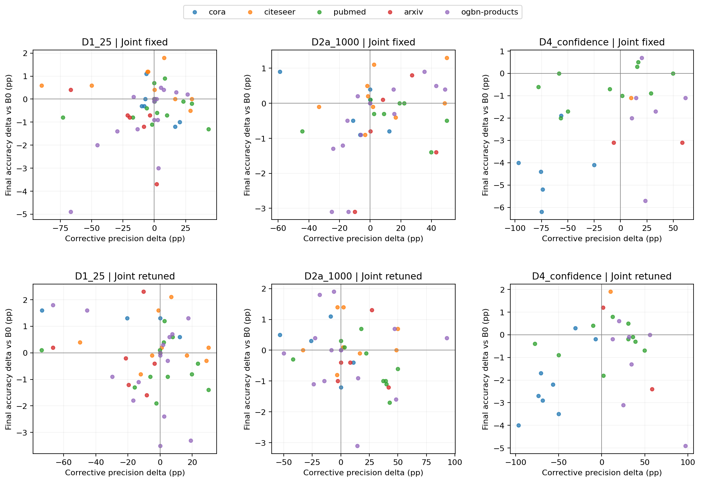
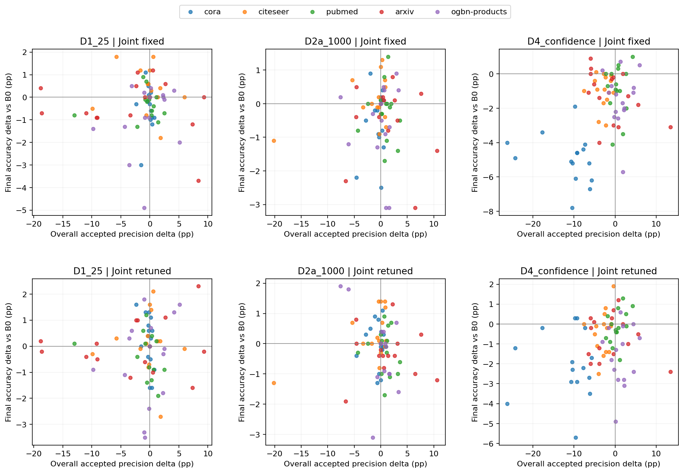
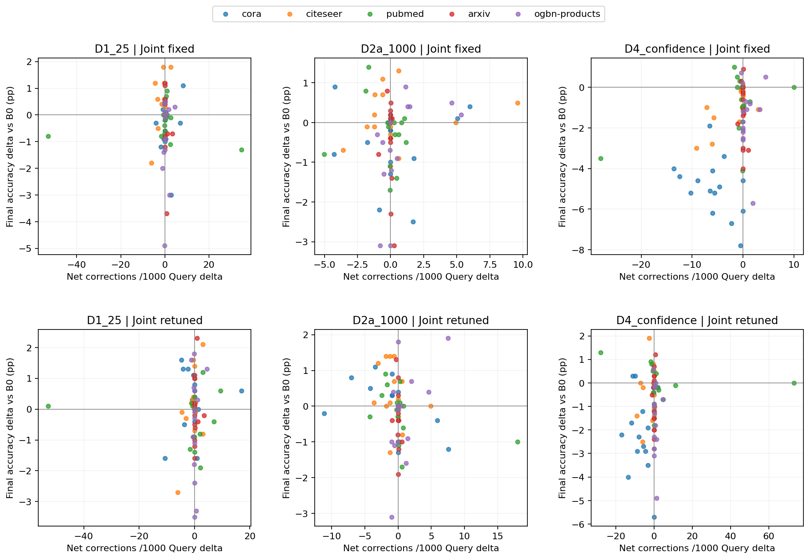

# 纠正性指标与最终准确率：配对相关及不确定性

全部使用相对B0的配对差值，D2匹配剔除新增训练节点后的Query。同一比较两种相关系数使用相同完整样本。按dataset×seed簇重采样4000次，保持同seed三种shot相依；数据集内只有5个seed簇，区间须谨慎解释。
不显著不能证明不相关；相关更强也不等于机制已被因果识别。Joint重调同时改变多项数值参数。

| Dataset | Treatment | Joint | Predictor | Method | n | r | Overall-precision r | Difference | Difference 95% CI |
|---|---|---|---|---|---:|---:|---:|---:|---|
| ALL | D1_25 | fixed | corrective_precision_delta_pp | Pearson | 51 | +0.162 | -0.037 | +0.199 | [-0.412, +0.633] |
| ALL | D1_25 | fixed | corrective_precision_delta_pp | Spearman | 51 | +0.082 | +0.040 | +0.042 | [-0.342, +0.426] |
| ALL | D1_25 | fixed | net_per_1000_query_delta | Pearson | 75 | -0.005 | -0.016 | +0.011 | [-0.307, +0.265] |
| ALL | D1_25 | fixed | net_per_1000_query_delta | Spearman | 75 | -0.038 | +0.018 | -0.056 | [-0.394, +0.305] |
| ALL | D1_25 | retuned | corrective_precision_delta_pp | Pearson | 48 | -0.238 | +0.079 | -0.317 | [-0.603, -0.017] |
| ALL | D1_25 | retuned | corrective_precision_delta_pp | Spearman | 48 | -0.063 | +0.082 | -0.145 | [-0.493, +0.189] |
| ALL | D1_25 | retuned | net_per_1000_query_delta | Pearson | 75 | +0.047 | +0.043 | +0.004 | [-0.146, +0.218] |
| ALL | D1_25 | retuned | net_per_1000_query_delta | Spearman | 75 | -0.074 | -0.007 | -0.067 | [-0.392, +0.230] |
| ALL | D2a_1000 | fixed | corrective_precision_delta_pp | Pearson | 42 | +0.283 | -0.224 | +0.507 | [+0.076, +0.791] |
| ALL | D2a_1000 | fixed | corrective_precision_delta_pp | Spearman | 42 | +0.345 | -0.063 | +0.407 | [+0.084, +0.715] |
| ALL | D2a_1000 | fixed | net_per_1000_query_delta | Pearson | 75 | +0.118 | +0.019 | +0.099 | [-0.238, +0.388] |
| ALL | D2a_1000 | fixed | net_per_1000_query_delta | Spearman | 75 | +0.071 | +0.032 | +0.040 | [-0.292, +0.384] |
| ALL | D2a_1000 | retuned | corrective_precision_delta_pp | Pearson | 42 | -0.197 | -0.373 | +0.177 | [-0.231, +0.485] |
| ALL | D2a_1000 | retuned | corrective_precision_delta_pp | Spearman | 42 | -0.211 | -0.319 | +0.107 | [-0.227, +0.417] |
| ALL | D2a_1000 | retuned | net_per_1000_query_delta | Pearson | 75 | -0.155 | -0.065 | -0.090 | [-0.531, +0.416] |
| ALL | D2a_1000 | retuned | net_per_1000_query_delta | Spearman | 75 | -0.308 | -0.127 | -0.181 | [-0.546, +0.257] |
| ALL | D4_confidence | fixed | corrective_precision_delta_pp | Pearson | 25 | +0.410 | +0.353 | +0.057 | [-0.245, +0.310] |
| ALL | D4_confidence | fixed | corrective_precision_delta_pp | Spearman | 25 | +0.352 | +0.260 | +0.092 | [-0.247, +0.444] |
| ALL | D4_confidence | fixed | net_per_1000_query_delta | Pearson | 75 | +0.406 | +0.440 | -0.034 | [-0.234, +0.290] |
| ALL | D4_confidence | fixed | net_per_1000_query_delta | Spearman | 75 | +0.323 | +0.331 | -0.007 | [-0.232, +0.235] |
| ALL | D4_confidence | retuned | corrective_precision_delta_pp | Pearson | 28 | +0.212 | +0.348 | -0.136 | [-0.426, +0.280] |
| ALL | D4_confidence | retuned | corrective_precision_delta_pp | Spearman | 28 | +0.185 | +0.329 | -0.144 | [-0.519, +0.203] |
| ALL | D4_confidence | retuned | net_per_1000_query_delta | Pearson | 75 | +0.101 | +0.251 | -0.150 | [-0.446, +0.171] |
| ALL | D4_confidence | retuned | net_per_1000_query_delta | Spearman | 75 | +0.072 | +0.219 | -0.147 | [-0.441, +0.141] |
| cora | D1_25 | fixed | corrective_precision_delta_pp | Pearson | 6 | -0.716 | -0.355 | -0.361 | [-0.707, +0.822] |
| cora | D1_25 | fixed | corrective_precision_delta_pp | Spearman | 6 | -0.406 | -0.754 | +0.348 | [+0.000, +1.481] |
| cora | D1_25 | fixed | net_per_1000_query_delta | Pearson | 15 | +0.163 | +0.095 | +0.068 | [-1.116, +1.519] |
| cora | D1_25 | fixed | net_per_1000_query_delta | Spearman | 15 | +0.144 | -0.382 | +0.526 | [-0.304, +1.439] |
| cora | D1_25 | retuned | corrective_precision_delta_pp | Pearson | 4 | -0.804 | -0.839 | +0.035 | [-0.000, +0.104] |
| cora | D1_25 | retuned | corrective_precision_delta_pp | Spearman | 4 | -0.800 | -0.800 | +0.000 | [+0.000, +0.000] |
| cora | D1_25 | retuned | net_per_1000_query_delta | Pearson | 15 | +0.159 | -0.467 | +0.626 | [+0.176, +1.015] |
| cora | D1_25 | retuned | net_per_1000_query_delta | Spearman | 15 | -0.214 | -0.456 | +0.242 | [-0.174, +0.578] |
| cora | D2a_1000 | fixed | corrective_precision_delta_pp | Pearson | 6 | -0.671 | -0.143 | -0.528 | [-0.800, +0.477] |
| cora | D2a_1000 | fixed | corrective_precision_delta_pp | Spearman | 6 | -0.348 | +0.029 | -0.376 | [-0.839, +0.000] |
| cora | D2a_1000 | fixed | net_per_1000_query_delta | Pearson | 15 | +0.033 | +0.239 | -0.206 | [-0.726, +0.579] |
| cora | D2a_1000 | fixed | net_per_1000_query_delta | Spearman | 15 | +0.079 | +0.050 | +0.029 | [-0.432, +0.620] |
| cora | D2a_1000 | retuned | corrective_precision_delta_pp | Pearson | 5 | -0.495 | +0.128 | -0.623 | [-2.000, +0.000] |
| cora | D2a_1000 | retuned | corrective_precision_delta_pp | Spearman | 5 | -0.600 | +0.400 | -1.000 | [-2.000, +0.000] |
| cora | D2a_1000 | retuned | net_per_1000_query_delta | Pearson | 15 | -0.477 | +0.021 | -0.498 | [-0.912, +0.007] |
| cora | D2a_1000 | retuned | net_per_1000_query_delta | Spearman | 15 | -0.643 | +0.089 | -0.732 | [-1.348, +0.104] |
| cora | D4_confidence | fixed | corrective_precision_delta_pp | Pearson | 6 | +0.272 | -0.275 | +0.547 | [-0.325, +1.435] |
| cora | D4_confidence | fixed | corrective_precision_delta_pp | Spearman | 6 | +0.143 | -0.886 | +1.029 | [+0.000, +1.529] |
| cora | D4_confidence | fixed | net_per_1000_query_delta | Pearson | 15 | -0.428 | -0.281 | -0.147 | [-0.688, +0.359] |
| cora | D4_confidence | fixed | net_per_1000_query_delta | Spearman | 15 | -0.476 | -0.357 | -0.119 | [-0.774, +0.397] |
| cora | D4_confidence | retuned | corrective_precision_delta_pp | Pearson | 8 | +0.804 | +0.429 | +0.374 | [-0.645, +1.633] |
| cora | D4_confidence | retuned | corrective_precision_delta_pp | Spearman | 8 | +0.619 | +0.238 | +0.381 | [-1.026, +1.585] |
| cora | D4_confidence | retuned | net_per_1000_query_delta | Pearson | 15 | -0.050 | +0.027 | -0.077 | [-0.859, +0.405] |
| cora | D4_confidence | retuned | net_per_1000_query_delta | Spearman | 15 | -0.082 | +0.002 | -0.084 | [-0.826, +0.225] |
| citeseer | D1_25 | fixed | corrective_precision_delta_pp | Pearson | 10 | -0.262 | +0.225 | -0.487 | [-1.310, +0.636] |
| citeseer | D1_25 | fixed | corrective_precision_delta_pp | Spearman | 10 | -0.562 | -0.084 | -0.478 | [-1.348, +0.652] |
| citeseer | D1_25 | fixed | net_per_1000_query_delta | Pearson | 15 | +0.414 | -0.139 | +0.553 | [-0.075, +1.154] |
| citeseer | D1_25 | fixed | net_per_1000_query_delta | Spearman | 15 | +0.002 | -0.204 | +0.206 | [-0.408, +0.920] |
| citeseer | D1_25 | retuned | corrective_precision_delta_pp | Pearson | 10 | -0.031 | +0.166 | -0.197 | [-0.948, +0.449] |
| citeseer | D1_25 | retuned | corrective_precision_delta_pp | Spearman | 10 | -0.012 | +0.330 | -0.342 | [-1.313, +0.559] |
| citeseer | D1_25 | retuned | net_per_1000_query_delta | Pearson | 15 | +0.570 | -0.023 | +0.593 | [-0.498, +1.058] |
| citeseer | D1_25 | retuned | net_per_1000_query_delta | Spearman | 15 | +0.190 | +0.054 | +0.136 | [-0.513, +0.906] |
| citeseer | D2a_1000 | fixed | corrective_precision_delta_pp | Pearson | 9 | +0.352 | +0.236 | +0.115 | [-0.321, +0.607] |
| citeseer | D2a_1000 | fixed | corrective_precision_delta_pp | Spearman | 9 | +0.435 | +0.259 | +0.176 | [-0.154, +0.909] |
| citeseer | D2a_1000 | fixed | net_per_1000_query_delta | Pearson | 15 | +0.175 | +0.396 | -0.221 | [-0.805, +0.559] |
| citeseer | D2a_1000 | fixed | net_per_1000_query_delta | Spearman | 15 | +0.041 | +0.106 | -0.065 | [-0.901, +0.881] |
| citeseer | D2a_1000 | retuned | corrective_precision_delta_pp | Pearson | 8 | +0.056 | +0.204 | -0.147 | [-0.786, +0.574] |
| citeseer | D2a_1000 | retuned | corrective_precision_delta_pp | Spearman | 8 | +0.193 | -0.024 | +0.217 | [-1.004, +0.943] |
| citeseer | D2a_1000 | retuned | net_per_1000_query_delta | Pearson | 15 | -0.239 | +0.544 | -0.783 | [-1.039, -0.345] |
| citeseer | D2a_1000 | retuned | net_per_1000_query_delta | Spearman | 15 | -0.378 | +0.272 | -0.650 | [-1.105, +0.145] |
| citeseer | D4_confidence | fixed | corrective_precision_delta_pp | Pearson | 1 | NA | NA | NA | NA |
| citeseer | D4_confidence | fixed | corrective_precision_delta_pp | Spearman | 1 | NA | NA | NA | NA |
| citeseer | D4_confidence | fixed | net_per_1000_query_delta | Pearson | 15 | +0.696 | -0.003 | +0.699 | [+0.142, +1.219] |
| citeseer | D4_confidence | fixed | net_per_1000_query_delta | Spearman | 15 | +0.510 | -0.107 | +0.617 | [+0.064, +1.271] |
| citeseer | D4_confidence | retuned | corrective_precision_delta_pp | Pearson | 1 | NA | NA | NA | NA |
| citeseer | D4_confidence | retuned | corrective_precision_delta_pp | Spearman | 1 | NA | NA | NA | NA |
| citeseer | D4_confidence | retuned | net_per_1000_query_delta | Pearson | 15 | +0.264 | +0.257 | +0.007 | [-0.840, +0.794] |
| citeseer | D4_confidence | retuned | net_per_1000_query_delta | Spearman | 15 | +0.134 | +0.273 | -0.139 | [-0.844, +0.757] |
| pubmed | D1_25 | fixed | corrective_precision_delta_pp | Pearson | 14 | +0.081 | +0.136 | -0.055 | [-0.969, +1.045] |
| pubmed | D1_25 | fixed | corrective_precision_delta_pp | Spearman | 14 | +0.112 | -0.123 | +0.236 | [-0.693, +1.199] |
| pubmed | D1_25 | fixed | net_per_1000_query_delta | Pearson | 15 | -0.048 | +0.143 | -0.191 | [-1.133, +0.416] |
| pubmed | D1_25 | fixed | net_per_1000_query_delta | Spearman | 15 | +0.066 | -0.140 | +0.207 | [-0.607, +0.887] |
| pubmed | D1_25 | retuned | corrective_precision_delta_pp | Pearson | 13 | -0.156 | -0.299 | +0.143 | [-0.276, +0.824] |
| pubmed | D1_25 | retuned | corrective_precision_delta_pp | Spearman | 13 | +0.050 | -0.548 | +0.598 | [-0.452, +1.248] |
| pubmed | D1_25 | retuned | net_per_1000_query_delta | Pearson | 15 | -0.080 | -0.253 | +0.174 | [-0.403, +0.413] |
| pubmed | D1_25 | retuned | net_per_1000_query_delta | Spearman | 15 | +0.090 | -0.407 | +0.497 | [-0.642, +1.079] |
| pubmed | D2a_1000 | fixed | corrective_precision_delta_pp | Pearson | 8 | -0.093 | -0.073 | -0.020 | [-0.264, +0.092] |
| pubmed | D2a_1000 | fixed | corrective_precision_delta_pp | Spearman | 8 | -0.241 | -0.241 | +0.000 | [+0.000, +0.000] |
| pubmed | D2a_1000 | fixed | net_per_1000_query_delta | Pearson | 15 | -0.126 | -0.017 | -0.110 | [-0.840, +0.911] |
| pubmed | D2a_1000 | fixed | net_per_1000_query_delta | Spearman | 15 | -0.203 | -0.108 | -0.095 | [-0.726, +0.859] |
| pubmed | D2a_1000 | retuned | corrective_precision_delta_pp | Pearson | 10 | -0.544 | -0.149 | -0.395 | [-0.868, -0.142] |
| pubmed | D2a_1000 | retuned | corrective_precision_delta_pp | Spearman | 10 | -0.717 | -0.164 | -0.553 | [-0.793, -0.125] |
| pubmed | D2a_1000 | retuned | net_per_1000_query_delta | Pearson | 15 | -0.374 | -0.121 | -0.253 | [-0.753, +0.064] |
| pubmed | D2a_1000 | retuned | net_per_1000_query_delta | Spearman | 15 | -0.449 | -0.127 | -0.322 | [-0.659, +0.409] |
| pubmed | D4_confidence | fixed | corrective_precision_delta_pp | Pearson | 10 | +0.468 | -0.079 | +0.547 | [-0.864, +1.259] |
| pubmed | D4_confidence | fixed | corrective_precision_delta_pp | Spearman | 10 | +0.322 | -0.091 | +0.413 | [-1.034, +1.500] |
| pubmed | D4_confidence | fixed | net_per_1000_query_delta | Pearson | 15 | +0.486 | +0.124 | +0.363 | [-0.946, +1.042] |
| pubmed | D4_confidence | fixed | net_per_1000_query_delta | Spearman | 15 | -0.228 | +0.102 | -0.330 | [-1.122, +0.400] |
| pubmed | D4_confidence | retuned | corrective_precision_delta_pp | Pearson | 10 | +0.194 | +0.179 | +0.015 | [-0.732, +0.561] |
| pubmed | D4_confidence | retuned | corrective_precision_delta_pp | Spearman | 10 | +0.127 | +0.285 | -0.158 | [-1.333, +0.654] |
| pubmed | D4_confidence | retuned | net_per_1000_query_delta | Pearson | 15 | -0.146 | +0.442 | -0.587 | [-1.369, -0.077] |
| pubmed | D4_confidence | retuned | net_per_1000_query_delta | Spearman | 15 | -0.406 | +0.463 | -0.869 | [-1.442, +0.106] |
| arxiv | D1_25 | fixed | corrective_precision_delta_pp | Pearson | 6 | -0.716 | -0.768 | +0.051 | [-0.427, +1.290] |
| arxiv | D1_25 | fixed | corrective_precision_delta_pp | Spearman | 6 | -0.754 | -0.986 | +0.232 | [+0.000, +0.866] |
| arxiv | D1_25 | fixed | net_per_1000_query_delta | Pearson | 15 | -0.279 | -0.168 | -0.111 | [-0.877, +0.217] |
| arxiv | D1_25 | fixed | net_per_1000_query_delta | Spearman | 15 | -0.480 | +0.029 | -0.509 | [-1.143, +0.412] |
| arxiv | D1_25 | retuned | corrective_precision_delta_pp | Pearson | 6 | -0.089 | +0.125 | -0.214 | [-0.760, +1.188] |
| arxiv | D1_25 | retuned | corrective_precision_delta_pp | Spearman | 6 | -0.429 | -0.143 | -0.286 | [-1.500, +0.500] |
| arxiv | D1_25 | retuned | net_per_1000_query_delta | Pearson | 15 | +0.052 | +0.129 | -0.077 | [-0.546, +0.624] |
| arxiv | D1_25 | retuned | net_per_1000_query_delta | Spearman | 15 | -0.294 | +0.041 | -0.335 | [-0.971, +0.137] |
| arxiv | D2a_1000 | fixed | corrective_precision_delta_pp | Pearson | 5 | +0.423 | -0.582 | +1.005 | [+0.000, +2.000] |
| arxiv | D2a_1000 | fixed | corrective_precision_delta_pp | Spearman | 5 | +0.400 | -0.600 | +1.000 | [+0.000, +2.000] |
| arxiv | D2a_1000 | fixed | net_per_1000_query_delta | Pearson | 15 | -0.187 | -0.139 | -0.048 | [-0.794, +0.206] |
| arxiv | D2a_1000 | fixed | net_per_1000_query_delta | Spearman | 15 | -0.360 | -0.050 | -0.310 | [-0.717, +0.531] |
| arxiv | D2a_1000 | retuned | corrective_precision_delta_pp | Pearson | 5 | +0.137 | -0.661 | +0.798 | [+0.000, +2.000] |
| arxiv | D2a_1000 | retuned | corrective_precision_delta_pp | Spearman | 5 | -0.051 | -0.821 | +0.769 | [+0.000, +2.000] |
| arxiv | D2a_1000 | retuned | net_per_1000_query_delta | Pearson | 15 | -0.245 | -0.038 | -0.206 | [-1.161, +0.327] |
| arxiv | D2a_1000 | retuned | net_per_1000_query_delta | Spearman | 15 | -0.456 | -0.078 | -0.378 | [-1.041, +0.543] |
| arxiv | D4_confidence | fixed | corrective_precision_delta_pp | Pearson | 2 | +0.999 | +0.999 | +0.000 | [+0.000, +0.000] |
| arxiv | D4_confidence | fixed | corrective_precision_delta_pp | Spearman | 2 | +1.000 | +1.000 | +0.000 | [+0.000, +0.000] |
| arxiv | D4_confidence | fixed | net_per_1000_query_delta | Pearson | 15 | -0.204 | -0.445 | +0.242 | [-0.362, +0.605] |
| arxiv | D4_confidence | fixed | net_per_1000_query_delta | Spearman | 15 | -0.076 | -0.486 | +0.410 | [-0.042, +0.714] |
| arxiv | D4_confidence | retuned | corrective_precision_delta_pp | Pearson | 2 | -1.000 | -1.000 | +0.000 | [+0.000, +0.000] |
| arxiv | D4_confidence | retuned | corrective_precision_delta_pp | Spearman | 2 | -1.000 | -1.000 | +0.000 | [+0.000, +0.000] |
| arxiv | D4_confidence | retuned | net_per_1000_query_delta | Pearson | 15 | +0.177 | -0.160 | +0.337 | [-0.766, +1.129] |
| arxiv | D4_confidence | retuned | net_per_1000_query_delta | Spearman | 15 | +0.126 | +0.032 | +0.094 | [-0.740, +0.680] |
| ogbn-products | D1_25 | fixed | corrective_precision_delta_pp | Pearson | 15 | +0.759 | +0.237 | +0.521 | [-0.494, +0.834] |
| ogbn-products | D1_25 | fixed | corrective_precision_delta_pp | Spearman | 15 | +0.691 | +0.308 | +0.384 | [-0.441, +0.948] |
| ogbn-products | D1_25 | fixed | net_per_1000_query_delta | Pearson | 15 | +0.147 | +0.237 | -0.090 | [-0.648, +0.222] |
| ogbn-products | D1_25 | fixed | net_per_1000_query_delta | Spearman | 15 | +0.292 | +0.308 | -0.015 | [-0.732, +0.400] |
| ogbn-products | D1_25 | retuned | corrective_precision_delta_pp | Pearson | 15 | -0.385 | +0.236 | -0.621 | [-1.109, +0.307] |
| ogbn-products | D1_25 | retuned | corrective_precision_delta_pp | Spearman | 15 | -0.125 | +0.261 | -0.386 | [-0.953, +0.465] |
| ogbn-products | D1_25 | retuned | net_per_1000_query_delta | Pearson | 15 | +0.148 | +0.236 | -0.087 | [-1.114, +0.513] |
| ogbn-products | D1_25 | retuned | net_per_1000_query_delta | Spearman | 15 | -0.207 | +0.261 | -0.468 | [-1.131, +0.343] |
| ogbn-products | D2a_1000 | fixed | corrective_precision_delta_pp | Pearson | 14 | +0.717 | +0.002 | +0.715 | [+0.266, +1.020] |
| ogbn-products | D2a_1000 | fixed | corrective_precision_delta_pp | Spearman | 14 | +0.852 | +0.150 | +0.702 | [+0.340, +1.221] |
| ogbn-products | D2a_1000 | fixed | net_per_1000_query_delta | Pearson | 15 | +0.490 | -0.003 | +0.493 | [+0.081, +1.045] |
| ogbn-products | D2a_1000 | fixed | net_per_1000_query_delta | Spearman | 15 | +0.681 | +0.118 | +0.563 | [+0.247, +1.101] |
| ogbn-products | D2a_1000 | retuned | corrective_precision_delta_pp | Pearson | 14 | -0.096 | -0.505 | +0.409 | [-0.825, +0.840] |
| ogbn-products | D2a_1000 | retuned | corrective_precision_delta_pp | Spearman | 14 | -0.035 | -0.283 | +0.248 | [-0.906, +0.851] |
| ogbn-products | D2a_1000 | retuned | net_per_1000_query_delta | Pearson | 15 | +0.532 | -0.519 | +1.051 | [-0.128, +1.503] |
| ogbn-products | D2a_1000 | retuned | net_per_1000_query_delta | Spearman | 15 | +0.579 | -0.305 | +0.884 | [-0.060, +1.636] |
| ogbn-products | D4_confidence | fixed | corrective_precision_delta_pp | Pearson | 6 | +0.081 | -0.108 | +0.189 | [-0.055, +0.953] |
| ogbn-products | D4_confidence | fixed | corrective_precision_delta_pp | Spearman | 6 | +0.087 | -0.406 | +0.493 | [+0.000, +1.750] |
| ogbn-products | D4_confidence | fixed | net_per_1000_query_delta | Pearson | 15 | +0.088 | +0.030 | +0.058 | [-0.330, +0.792] |
| ogbn-products | D4_confidence | fixed | net_per_1000_query_delta | Spearman | 15 | +0.030 | +0.034 | -0.003 | [-0.638, +0.740] |
| ogbn-products | D4_confidence | retuned | corrective_precision_delta_pp | Pearson | 7 | -0.681 | +0.190 | -0.871 | [-1.547, +0.708] |
| ogbn-products | D4_confidence | retuned | corrective_precision_delta_pp | Spearman | 7 | -0.357 | +0.357 | -0.714 | [-1.579, +0.947] |
| ogbn-products | D4_confidence | retuned | net_per_1000_query_delta | Pearson | 15 | -0.017 | +0.087 | -0.104 | [-0.863, +0.692] |
| ogbn-products | D4_confidence | retuned | net_per_1000_query_delta | Spearman | 15 | -0.070 | +0.025 | -0.095 | [-1.095, +0.978] |

