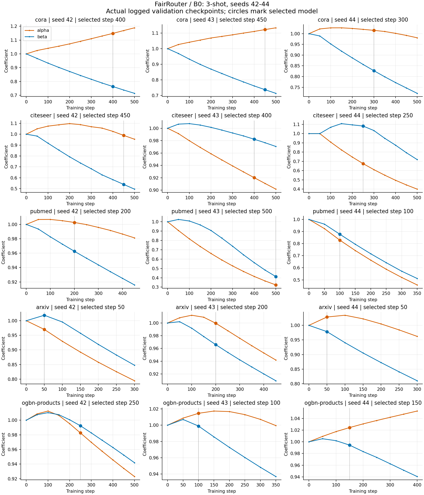
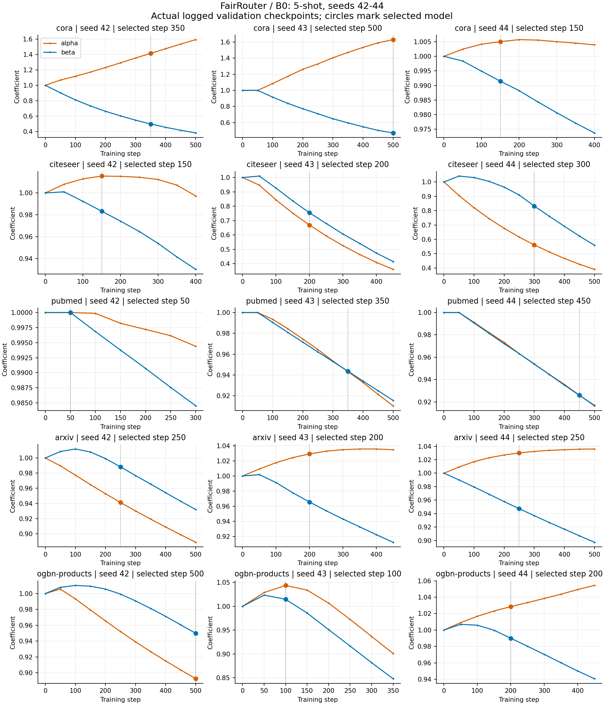
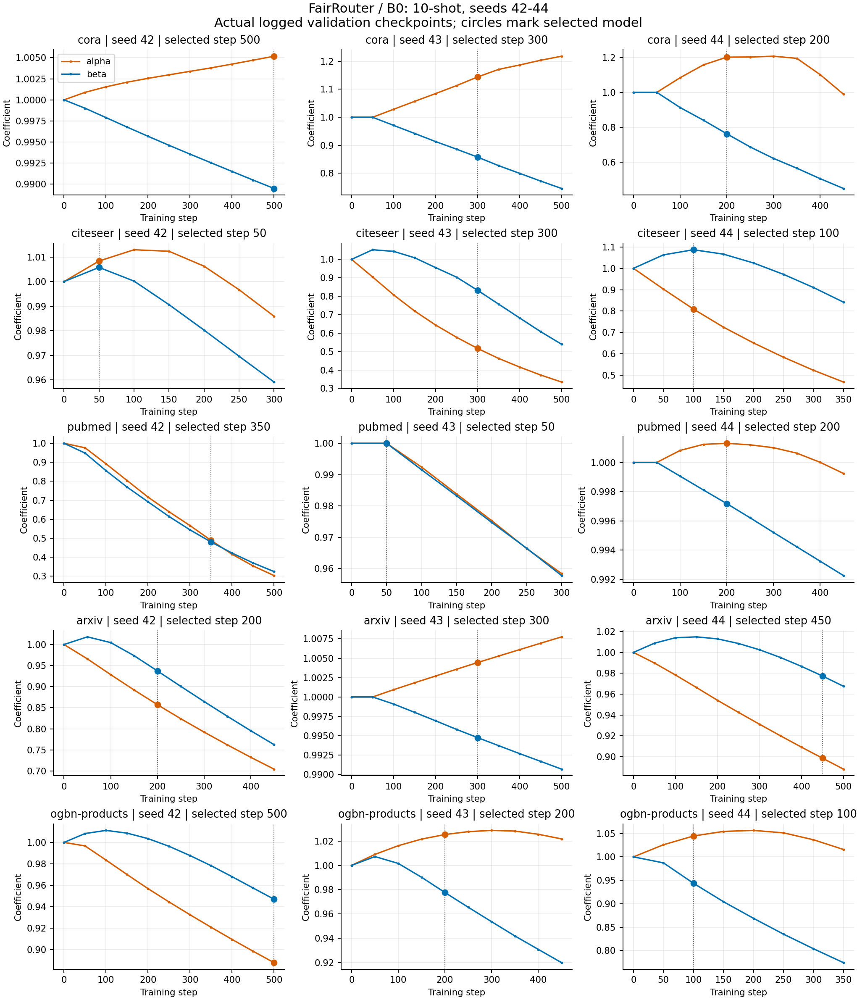
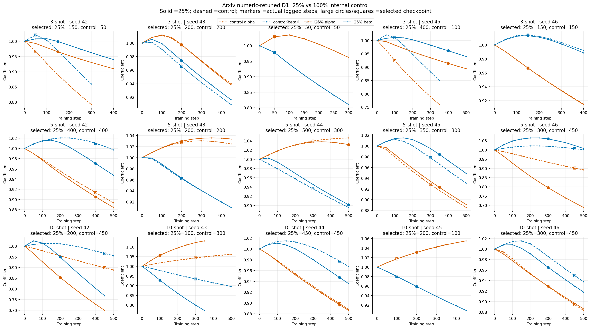
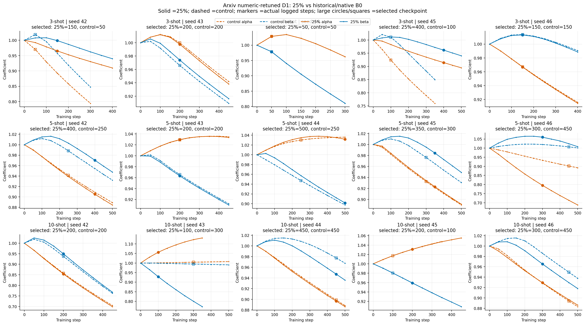

# B0 / FairRouter residual模块与25%重调参D1诊断

时间（Asia/Shanghai）：2026-10-28T17:56:14.270546+08:00

45组历史B0训练曲线：3/5/10-shot × seeds42–44 × 5数据集。分类消融另外覆盖全部75组B0；Arxiv同时覆盖seeds42–46、三种shot的D1 25%和100%内部对照，共105份已冻结模型。无重新训练，无新模型选择。所有分类准确率与标签改变率均在各seed原顺序eval1000上计算；Router伪标签指标引用已封存的完整Query报告。

## 代码与公式

实际模型是 `src/eargtc/joint_explore/joint_purf_v10_v1/model.py` 的 `UnifiedRepair`：两侧embedding分别LayerNorm、线性投影、GELU，拼接后经64宽隐藏层与分类层得到pR。专家输入detach，alpha/beta经softplus为正。

`pJ=(alpha*pG+beta*pL+pR)/(alpha+beta+1)`。用户省略的分母不影响argmax。去掉pR后使用`(alpha*pG+beta*pL)/(alpha+beta)`，不重新训练、不重调alpha/beta。pR单独准确率使用argmax(pR)。这里pR是单独的归一化概率分类头，不是可正可负的logit残差。

| 核查内容 | 仓库位置 |
|---|---|
| residual结构、alpha/beta、融合 | [model.py](../../src/eargtc/joint_explore/joint_purf_v10_v1/model.py#L8-L37) |
| 优化器、监督/伪标签损失、checkpoint和系数日志 | [training.py](../../src/eargtc/joint_explore/joint_purf_v10_v1/training.py#L34-L112) |
| B0历史大表重训与精确一致性检查 | [cli.py](../../src/enhancerouter/cli.py#L84-L142) |
| 专家特征、gold/selection与伪标签池 | [adapter.py](../../src/enhancerouter/adapter.py#L16-L90) |
| 当前B0原生Joint训练入口 | [compute.py](../../experiments/stage0_20261026/compute.py#L103-L121) |
| 25%重调参D1及Joint受控搜索 | [d1_numeric.py](../../experiments/stage0_20261027/d1_numeric.py#L29-L48) |
| 本次拆分、核验与作图 | [analyze_residual.py](../../experiments/stage0_20261027/analyze_residual.py) |

训练使用AdamW：residual参数学习率lr、weight_decay=1e-4；alpha/beta原始参数学习率lr×gate_lr、不做weight decay。损失包含gold混合预测NLL、按cross加权的两个方向伪标签NLL，及配置允许的aux residual NLL和keep一致区KL；warmup/gate_gold决定何时截断系数梯度。按validation accuracy、NLL、较早step选checkpoint。

## 45组B0系数曲线

每个子图一组配置，两条线分别为原始正系数alpha/beta。原训练history在step0和验证时刻记录，默认每50steps；图中点全部来自原记录，不冒充逐optimizer-step轨迹。圆点/竖线标记最终选中的checkpoint；曲线可继续到早停末步，末点不一定是选中的模型。

[45组矢量PDF](figures/B0_historical45_alpha_beta.pdf)

### 3-shot

### 5-shot

### 10-shot

## 历史45组B0：pR单独、移除pR及标签改变区

百分数均以固定1000节点为分母；每格为对应shot、dataset的三个seed均值。改变区为加入pR后相对无pR的argmax改变比例。改对/改错各自以1000为分母。

| 数据集 | shot | 完整pJ准确率 | pR单独准确率 | 去pR准确率 | pR改变标签比例 | 改对 | 改错 |
|---|---:|---:|---:|---:|---:|---:|---:|
| cora | 3 | 79.37 | 76.47 | 76.83 | 12.87 | 6.33 | 3.80 |
| citeseer | 3 | 73.37 | 72.23 | 72.30 | 10.57 | 4.57 | 3.50 |
| pubmed | 3 | 90.80 | 90.37 | 87.23 | 10.13 | 6.63 | 3.07 |
| arxiv | 3 | 58.13 | 52.47 | 53.40 | 14.67 | 6.87 | 2.13 |
| ogbn-products | 3 | 72.30 | 65.37 | 69.47 | 8.63 | 4.50 | 1.67 |
| cora | 5 | 80.70 | 76.57 | 78.10 | 11.83 | 6.00 | 3.40 |
| citeseer | 5 | 72.60 | 69.07 | 73.70 | 10.47 | 3.33 | 4.43 |
| pubmed | 5 | 91.47 | 90.93 | 89.63 | 5.37 | 3.40 | 1.57 |
| arxiv | 5 | 60.40 | 53.57 | 55.83 | 16.10 | 7.07 | 2.50 |
| ogbn-products | 5 | 72.43 | 61.03 | 69.50 | 10.43 | 4.53 | 1.60 |
| cora | 10 | 81.27 | 79.20 | 78.87 | 11.57 | 5.83 | 3.43 |
| citeseer | 10 | 73.47 | 68.33 | 73.57 | 8.50 | 3.40 | 3.50 |
| pubmed | 10 | 91.63 | 91.27 | 89.90 | 5.67 | 3.60 | 1.87 |
| arxiv | 10 | 61.60 | 54.60 | 54.57 | 23.00 | 10.47 | 3.43 |
| ogbn-products | 10 | 72.80 | 67.20 | 70.40 | 8.70 | 4.03 | 1.63 |

全部75组B0及每个seed原始值见per_cell.csv；JSON还保留alpha/beta、归一化wR、选中step、真实文件路径和哈希。逐节点的改对、改错、改成另一错误类见cells/内eval1000_decomposition.csv。精确恒等式：完整正确数−去pR正确数＝改对数−改错数；已对105份模型逐一验证。

## Arxiv：25%重调参实验的对应关系

25%实验定位为`runs/stage0-20261026-v2/cells/shot{3,5,10}/seed{42..46}/arxiv/d1_numeric/0.25`。`d1_numeric/1.0`为相同重调流程的100%内部对照，不能直接当作历史B0。下表使用完整15组，明确区分两种参照；旧eval1000 Router快照另存JSON的old_report_claim_trace，不能混入完整Query结果。

这里25%仅下采样Router目标训练bank的support父节点，见d1_numeric.py的parents/getter；后续compute.joint仍用原split及supervision，adapter.py仍把全部support_ids作为gold_ids。因此Joint residual的直接gold监督没有缩成25%。逐组router_target_parent_selection_count与joint_gold_support_count已单列，不能把本实验解释为整个端到端模型只剩25%金标签。

| 参照 | shot | 组数 | 25%−参照 P@1% pp | P@5% pp | P@20% pp | 实际接受伪标签精度pp | 最终分类准确率pp |
|---|---|---:|---:|---:|---:|---:|---:|
| b0 | ALL | 15 | -7.45 | -5.22 | -2.85 | -3.15 | -0.00 |
| b0 | 3 | 5 | +0.19 | -1.08 | -0.44 | +2.19 | -0.40 |
| b0 | 5 | 5 | -13.86 | -10.72 | -6.46 | -6.78 | -0.02 |
| b0 | 10 | 5 | -8.69 | -3.87 | -1.66 | -4.85 | +0.42 |
| d1_numeric/1.0 | ALL | 15 | -10.29 | -5.86 | -2.88 | -4.47 | +0.04 |
| d1_numeric/1.0 | 3 | 5 | -5.02 | -2.87 | -0.14 | -0.42 | -0.22 |
| d1_numeric/1.0 | 5 | 5 | -13.52 | -10.38 | -6.36 | -7.15 | +0.20 |
| d1_numeric/1.0 | 10 | 5 | -12.35 | -4.32 | -2.14 | -5.84 | +0.14 |

“接近10pp”需要指定P@k与参照；本报告不把P@1%、P@20%或不同完成快照混用。上表最终分类差值为完整五seed结果，请据此核对用户提到的−0.10pp。

## Arxiv：每个shot、五个seed的分类分解

| shot | seed | 配置 | pJ准确率 | pR单独准确率 | 去pR准确率 | pR改变标签比例 | 改对 | 改错 | alpha | beta | wR | 选中step |
|---|---:|---|---:|---:|---:|---:|---:|---:|---:|---:|---:|---:|
| 3 | 42 | b0 | 58.00 | 49.80 | 52.40 | 14.60 | 8.00 | 2.40 | 0.9701 | 1.0187 | 33.46 | 50 |
| 3 | 42 | d1_numeric/0.25 | 56.80 | 48.00 | 52.40 | 15.90 | 6.60 | 2.20 | 0.9653 | 0.9989 | 33.74 | 150 |
| 3 | 42 | d1_numeric/1.0 | 58.40 | 53.50 | 52.40 | 14.50 | 7.70 | 1.70 | 0.9672 | 1.0204 | 33.47 | 50 |
| 3 | 43 | b0 | 58.30 | 53.90 | 52.70 | 17.70 | 8.00 | 2.40 | 0.9996 | 0.9660 | 33.72 | 200 |
| 3 | 43 | d1_numeric/0.25 | 56.70 | 53.60 | 52.60 | 18.40 | 6.90 | 2.80 | 0.9976 | 0.9740 | 33.65 | 200 |
| 3 | 43 | d1_numeric/1.0 | 57.30 | 52.40 | 52.70 | 19.20 | 7.70 | 3.10 | 0.9971 | 0.9655 | 33.75 | 200 |
| 3 | 44 | b0 | 58.10 | 53.70 | 55.10 | 11.70 | 4.60 | 1.60 | 1.0286 | 0.9784 | 33.26 | 50 |
| 3 | 44 | d1_numeric/0.25 | 58.10 | 53.70 | 55.10 | 11.70 | 4.60 | 1.60 | 1.0286 | 0.9784 | 33.26 | 50 |
| 3 | 44 | d1_numeric/1.0 | 58.10 | 53.70 | 55.10 | 11.70 | 4.60 | 1.60 | 1.0286 | 0.9784 | 33.26 | 50 |
| 3 | 45 | b0 | 55.50 | 53.10 | 49.70 | 16.80 | 7.60 | 1.80 | 0.9239 | 1.0106 | 34.08 | 100 |
| 3 | 45 | d1_numeric/0.25 | 56.50 | 53.10 | 49.70 | 25.20 | 9.70 | 2.90 | 0.9142 | 0.9614 | 34.78 | 400 |
| 3 | 45 | d1_numeric/1.0 | 55.50 | 53.10 | 49.70 | 16.80 | 7.60 | 1.80 | 0.9239 | 1.0106 | 34.08 | 100 |
| 3 | 46 | b0 | 57.90 | 46.70 | 52.50 | 12.60 | 6.30 | 0.90 | 0.9672 | 1.0138 | 33.55 | 150 |
| 3 | 46 | d1_numeric/0.25 | 57.70 | 41.80 | 52.50 | 13.20 | 6.00 | 0.80 | 0.9668 | 1.0132 | 33.56 | 150 |
| 3 | 46 | d1_numeric/1.0 | 57.60 | 42.30 | 52.50 | 13.60 | 6.30 | 1.20 | 0.9668 | 1.0142 | 33.55 | 150 |
| 5 | 42 | b0 | 59.40 | 52.50 | 52.50 | 18.10 | 8.60 | 1.70 | 0.9413 | 0.9883 | 34.13 | 250 |
| 5 | 42 | d1_numeric/0.25 | 59.50 | 54.70 | 52.50 | 21.50 | 9.30 | 2.30 | 0.9051 | 0.9703 | 34.78 | 400 |
| 5 | 42 | d1_numeric/1.0 | 59.40 | 52.50 | 52.50 | 22.40 | 9.90 | 3.00 | 0.9134 | 1.0101 | 34.21 | 400 |
| 5 | 43 | b0 | 59.20 | 51.80 | 56.70 | 12.80 | 5.30 | 2.80 | 1.0293 | 0.9655 | 33.39 | 200 |
| 5 | 43 | d1_numeric/0.25 | 60.30 | 52.30 | 56.70 | 12.40 | 5.60 | 2.00 | 1.0296 | 0.9632 | 33.41 | 200 |
| 5 | 43 | d1_numeric/1.0 | 59.70 | 54.30 | 56.70 | 15.90 | 6.30 | 3.30 | 1.0274 | 0.9622 | 33.45 | 200 |
| 5 | 44 | b0 | 62.60 | 56.40 | 58.30 | 17.40 | 7.30 | 3.00 | 1.0301 | 0.9473 | 33.59 | 250 |
| 5 | 44 | d1_numeric/0.25 | 62.10 | 59.60 | 58.00 | 18.60 | 7.40 | 3.30 | 1.0317 | 0.9015 | 34.09 | 500 |
| 5 | 44 | d1_numeric/1.0 | 61.50 | 53.80 | 58.10 | 16.80 | 6.70 | 3.30 | 1.0395 | 0.9361 | 33.61 | 300 |
| 5 | 45 | b0 | 57.80 | 52.40 | 49.40 | 19.80 | 10.00 | 1.60 | 0.9324 | 0.9764 | 34.38 | 300 |
| 5 | 45 | d1_numeric/0.25 | 58.00 | 53.60 | 49.40 | 20.60 | 10.50 | 1.90 | 0.9229 | 0.9843 | 34.40 | 350 |
| 5 | 45 | d1_numeric/1.0 | 57.30 | 49.50 | 49.40 | 19.80 | 9.50 | 1.60 | 0.9284 | 0.9780 | 34.41 | 300 |
| 5 | 46 | b0 | 58.60 | 49.50 | 52.60 | 23.50 | 9.00 | 3.00 | 0.9016 | 1.0069 | 34.38 | 450 |
| 5 | 46 | d1_numeric/0.25 | 57.60 | 44.90 | 52.50 | 30.70 | 10.30 | 5.20 | 0.7955 | 1.0600 | 35.02 | 300 |
| 5 | 46 | d1_numeric/1.0 | 58.60 | 49.50 | 52.60 | 23.50 | 9.00 | 3.00 | 0.9016 | 1.0069 | 34.38 | 450 |
| 10 | 42 | b0 | 60.80 | 55.40 | 52.50 | 27.30 | 12.00 | 3.70 | 0.8574 | 0.9374 | 35.78 | 200 |
| 10 | 42 | d1_numeric/0.25 | 60.60 | 57.70 | 52.50 | 26.90 | 11.30 | 3.20 | 0.8539 | 0.9493 | 35.67 | 200 |
| 10 | 42 | d1_numeric/1.0 | 62.60 | 58.50 | 52.50 | 23.00 | 12.60 | 2.50 | 0.8986 | 0.9660 | 34.91 | 450 |
| 10 | 43 | b0 | 62.80 | 51.70 | 59.70 | 18.20 | 7.30 | 4.20 | 1.0044 | 0.9948 | 33.34 | 300 |
| 10 | 43 | d1_numeric/0.25 | 65.10 | 61.40 | 60.10 | 16.10 | 7.70 | 2.70 | 1.0563 | 0.9287 | 33.50 | 100 |
| 10 | 43 | d1_numeric/1.0 | 62.40 | 61.20 | 60.00 | 14.80 | 5.70 | 3.30 | 1.0434 | 0.9347 | 33.58 | 300 |
| 10 | 44 | b0 | 61.20 | 56.70 | 51.50 | 23.50 | 12.10 | 2.40 | 0.8986 | 0.9774 | 34.77 | 450 |
| 10 | 44 | d1_numeric/0.25 | 60.80 | 55.00 | 51.50 | 26.20 | 12.00 | 2.70 | 0.8966 | 0.9470 | 35.17 | 450 |
| 10 | 44 | d1_numeric/1.0 | 61.20 | 56.70 | 51.50 | 23.50 | 12.10 | 2.40 | 0.8986 | 0.9774 | 34.77 | 450 |
| 10 | 45 | b0 | 62.00 | 45.10 | 58.20 | 11.30 | 5.90 | 2.10 | 1.0173 | 0.9804 | 33.36 | 100 |
| 10 | 45 | d1_numeric/0.25 | 63.00 | 53.40 | 58.30 | 14.40 | 6.90 | 2.20 | 1.0309 | 0.9591 | 33.44 | 200 |
| 10 | 45 | d1_numeric/1.0 | 62.00 | 45.10 | 58.20 | 11.30 | 5.90 | 2.10 | 1.0173 | 0.9804 | 33.36 | 100 |
| 10 | 46 | b0 | 62.00 | 51.20 | 52.60 | 21.80 | 11.00 | 1.60 | 0.8941 | 0.9494 | 35.17 | 450 |
| 10 | 46 | d1_numeric/0.25 | 61.40 | 47.70 | 52.60 | 18.50 | 10.30 | 1.50 | 0.9293 | 0.9654 | 34.55 | 300 |
| 10 | 46 | d1_numeric/1.0 | 62.00 | 51.20 | 52.60 | 21.80 | 11.00 | 1.60 | 0.8941 | 0.9494 | 35.17 | 450 |

## Arxiv：五seed训练系数曲线

每个面板对应一个shot/seed。第一图比较25%与100%内部对照；第二图比较25%与B0。实线为25%，虚线为参照，橙色为alpha、蓝色为beta；较大的圆/方标记为各自validation选中的checkpoint。

[矢量PDF：25% vs100%](figures/Arxiv_D1_25_vs_100.pdf)

[矢量PDF：25% vs B0](figures/Arxiv_D1_25_vs_B0.pdf)

## 文件及验证

- per_cell.csv：105份冻结分类器的全部分解指标，B0共75份；要求的历史45份有historical_45=true标记。
- coefficient_history.csv：原训练已保存的全部step记录和归一化三分支权重，含105份模型。
- arxiv_paired.csv：15组25%分别对照B0/100%的配对差。
- cells/：每组完整结果、系数history、1000节点分解CSV、完成哈希。
- figures/：三张B0合集、一个三页45组PDF、Arxiv两张15组配对图，以及45组B0和15组25%D1各自的单独PNG/PDF。
- 全部预测已核对冻结完整pJ概率（绝对容差2e-6）、argmax标签逐节点完全一致、accuracy与已发布值一致；无训练、无按Query标签选模型。
- pR改变标签比例只衡量固定checkpoint的直接推理贡献，不等价于重新训练一个无residual模型的效果；pR单独推理也不是独立训练的分类器。
- 原始模型和输入只读；本次输出保存于新的residual-audit运行目录，未覆盖任何旧结果。

